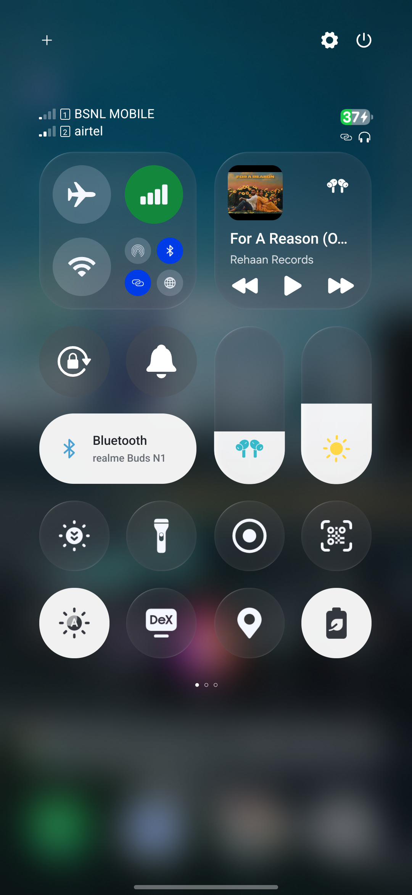
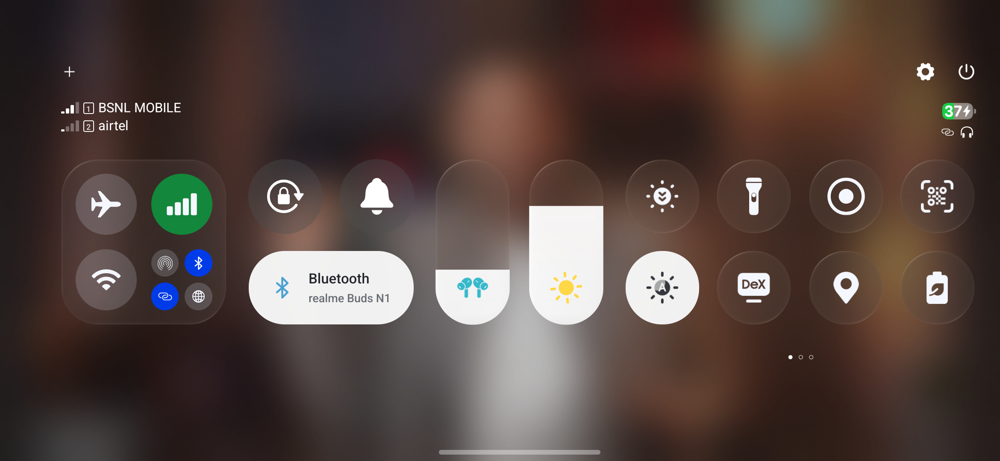
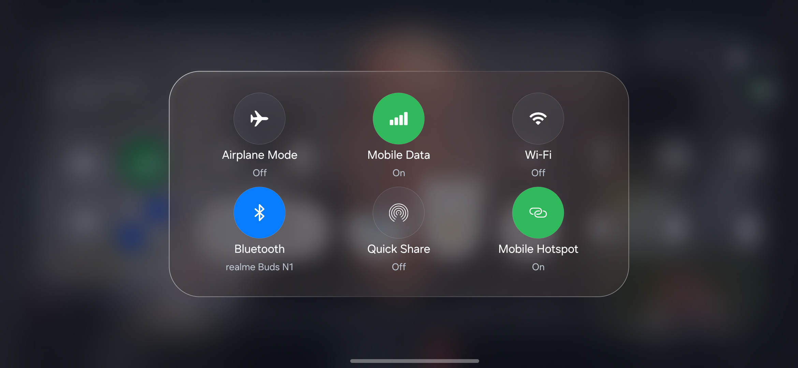

<h1 align="center">IGlassControl · One UI 9</h1>

A glass Control Center for Samsung · Maintained by <a href="https://github.com/Rient108">Rient108</a>

<a href="https://github.com/Rient108/IGlassControl-OneUI9/releases/tag/v3.0-build94">Download build 94</a> · <a href="CHANGELOG.md">What changed</a>

## Preview

## Features

- Glass surfaces with curved edge highlights and a background that updates over playing video.
- Portrait and landscape layouts with the same control icons; the media card stays hidden in landscape.
- A Bluetooth device pill, large Mobile Data control and compact sharing button.
- Two rows of Samsung controls with swipeable pages.
- Working Wi-Fi, Bluetooth, brightness, volume and native Samsung tile actions.
- Media artwork and playback controls from active Android media sessions.
- Expanded connection controls, torch brightness and other supported detail panels.
- Upward swipe dismissal and Settings shortcuts that close the shade before navigation.

## Installation

1. Use a rooted Samsung phone running One UI 9 with LSPosed installed.
2. Download and install **IGlassControl-OneUI9-build94.apk** from Releases.
3. Enable **Glass Control** in LSPosed and scope it to **System UI (`com.android.systemui`) only**.
4. Disable conflicting Control Center replacements, then restart SystemUI or reboot.
5. Use Samsung's separate notification/quick-settings mode: top-right opens controls; the other side opens notifications.

## Everyday use

Tap Wi-Fi or Bluetooth to toggle; hold for device options. Hold Mobile Data to expand connections. Hold brightness, volume or torch for their supported controls. Swipe the lower controls horizontally for more tiles. Swipe upward away from a slider to close the panel. Hold a native tile for its settings.

## Compatibility and status

Build **94** is a preview tested on a connected Samsung One UI 9 device. Private Samsung integration can differ between firmware versions. Dynamic blur was observed over a playing YouTube video, including landscape. Some frame drops remain; consistent 120 FPS and an exact iOS match are not guaranteed.

This is an Android LSPosed module with iOS-inspired styling. Apple-only services are not provided. Icon and dependency notices are retained in the build assets.

## Recovery

Disable Glass Control in LSPosed and restart SystemUI to return to Samsung's panel.

This public repository distributes the APK, screenshots and release documentation. Development source and signing material are not included.
